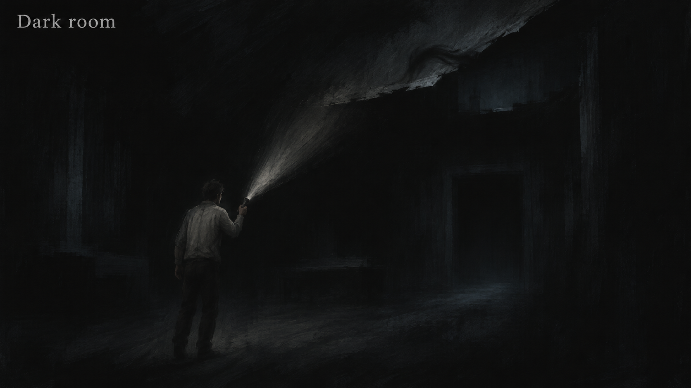
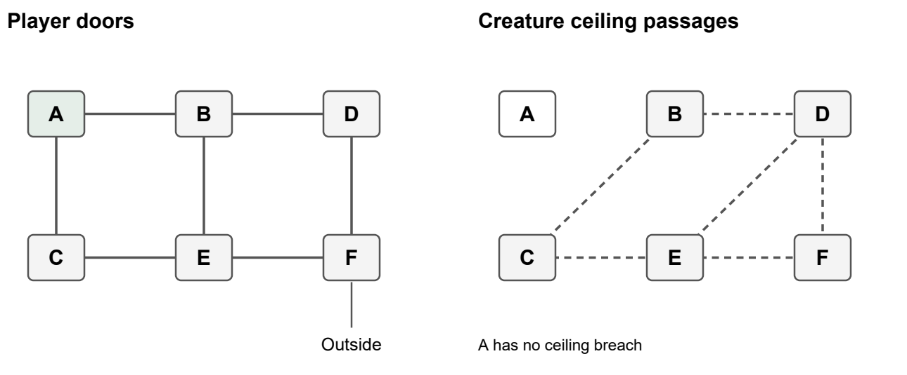

# Dark room

## Game design document

Version 1.0 | 13 November 2026 | Single player psychological survival horror

Find the right route through a dark building and escape. A shadow creature travels between rooms through holes in the ceilings, stalking the player from above, beneath furniture, and inside dark corners. A focused torch beam drives it away. Room lights provide shelter, but some fail and must be restored at wall switches. Every heavy door takes time to push open, leaving the player's back exposed.

The experience is built around one question: **Can I make enough safety to open this door before the creature reaches me?** Navigation supplies the longer goal; managing light and exposure supplies the moment to moment play.

The concept image shows the intended spatial relationships and mood. Character appearance, architecture, and interface are visual proposals rather than specifications for existing assets.

### Design foundation

The required features are route finding, a lethal shadow monster, torch repulsion, slow doors, unreliable room lights, wall switches, and ceiling connections between rooms. Camera, layout, timings, health values, and encounter schedules below define a proposed first playable version. Numerical values are starting points for playtesting.

Target the first complete level at 10 to 15 minutes on a first successful run. Build a compact authored level before procedural generation or additional enemy types.

<!-- PAGEBREAK -->

## 1 Player experience and objective

### The level objective

Reach the exterior through the final exit beyond Room F. The opening objective reads: **Find a way out.** A recognizable exterior landing is visible through the starting room's window, establishing a destination without revealing the complete route.

Two connected routes reach the exit. Neither requires collecting keys or defeating the creature. The shorter route has more exposed door positions; the alternative offers a useful light but requires operating its switch. A connecting door lets players change their decision midway. Dead ends reveal landmarks or a view of the exit, and are short enough to leave safely.

Success occurs when the player crosses the exterior threshold. Play a short escape beat and end the level. Do not invalidate the escape by immediately returning the player to the starting room.

### Core gameplay loop

1. Enter and orient. Identify doors, windows, switches, bright areas, and ceiling holes.
2. Read the threat. Listen for movement and check likely hiding places.
3. Choose a route. Compare distance, available light, and the creature's last known position.
4. Make an opening. Restore a room light or repel the creature with the torch.
5. Push a door. Commit time while listening for an approach behind or above.
6. Interrupt if needed. Release the door, turn, defend, and reposition.
7. Advance. Enter the next room, recognize a landmark, and update the route.

The loop repeats with different geometry and lighting. Progress comes from learning the building and changing its doors, rather than accumulating supplies.

### Example encounter

The player enters a bedroom and hears scratching overhead. They locate the creature at a ceiling hole and hold the focused beam on it until it retreats. They cross to the next door and push for two seconds. Scratching moves through the ceiling toward a hole behind them. The player releases the door, turns, repels the creature again, and finishes opening the door. Its opening progress remains intact.

### Emotional rhythm

Alternate orientation, anticipation, danger, and relief. A room should offer several quiet seconds to read its layout before its first attack. After a successful repulsion, allow useful progress. Continuous attacks would overwhelm both route finding and dread.

<!-- PAGEBREAK -->

## 2 Camera controls and survival

### Camera and movement

Use a close third person camera so the existing hero remains visible. Allow aiming up to inspect the ceiling and down to inspect low hiding spaces. The hero, furniture, and doorway frames must not obscure the focused beam's aim point. Fade nearby occluding geometry when necessary.

Walk speed starts at 2.0 metres per second, sprint at 3.5, and focused movement at 1.2. Sprinting creates more noise and makes precise aiming difficult. Do not add stamina management to the first version. Crouching improves inspection and clearance; it does not make the hero invisible.

| Action           | Keyboard and mouse | Controller            |
| ---------------- | ------------------ | --------------------- |
| Move and look    | WASD and mouse     | Left and right sticks |
| Focus torch      | Hold right mouse   | Hold left trigger     |
| Interact or push | Hold E             | Hold X or Square      |
| Sprint           | Hold Shift         | Hold left stick press |
| Crouch           | C                  | B or Circle           |
| Toggle torch     | F                  | D pad up              |
| Pause            | Escape             | Menu                  |

Inputs are rebindable. Provide toggle alternatives for sustained focus and push actions. When pushing, directional input away from the door or releasing interact immediately cancels the action. Aiming input also cancels pushing and returns control to the torch.

### Health and death

The hero dies after three standard hits. Each confirmed hit removes one health mark, briefly interrupts the current action, and grants 1.5 seconds of damage protection. The creature withdraws for at least three seconds after a successful hit, preventing repeated contact damage from becoming an unavoidable death.

After two hits, breathing becomes strained and one remaining health mark is emphasized. Preserve visibility and directional sound; injury effects must not conceal the next warning. There is no healing pickup or automatic health regeneration in this level.

### Restart and persistence

Save at the start and when the player reaches the protected doorway niche in Room D or Room E. Both routes therefore offer a checkpoint. The niche contains a dependable light and no ceiling breach.

On death, restore the checkpoint snapshot: full health, recorded door progress, switch states, discovered route information, and encounter stage. Reset the creature to a legal hiding node outside the protected area with an arrival grace period. Do not preserve damage while resetting the surrounding world to an earlier state.

<!-- PAGEBREAK -->

## 3 Torch defense

### Two beam modes

The torch is always available and starts switched on. Its broad beam reveals the room but does not repel the creature. Holding focus narrows the beam and increases effective exposure on the target. The player must track the creature rather than sweep the whole room indiscriminately.

Start with an 8 metre effective focus range, an 18 degree full beam angle, and 0.8 seconds of accumulated exposure to trigger retreat. Walls, furniture, and door panels block exposure. Aim at the creature's visible body; illuminating the ceiling hole beside it has no effect.

Exposure is evaluated on several body points so thin limbs or a partially visible torso remain reasonably targetable. Losing the target pauses exposure, then it decays over 0.5 seconds. A small hand movement should not erase all progress instantly.

### Repulsion result

On reaching the exposure threshold, the creature recoils, gives a distinct sound, and retreats to a reachable dark hiding node. It cannot inflict damage during that retreat. Its next attack cannot begin for at least four seconds after retreat starts. Travel to a distant node can extend this window.

The torch never kills the creature and never seals a ceiling connection. Repulsion creates time to move, reset a light, or push a door. The creature may later return from another room, using the ceiling network.

### Limits and feedback

Focus slows movement and narrows peripheral awareness. Only one target direction can be covered at a time. The first level uses unlimited torch energy: the scarce resources are attention, safe space, health, and time. Battery collection and torch overheating would add production scope without being necessary for this loop.

Give exposure three readable stages: the creature shields or twists away, its movement becomes hesitant, then it breaks into retreat. Use animation, a restrained sound response, and a slight beam reaction. Do not require an enemy health bar.

### Close encounters

An attack begins with a minimum 1.2 second tell, such as a body unfolding or a sharp intake of breath. Sufficient focused exposure before contact cancels the attack. If the player aims too late, the hit resolves once and damage protection begins. Attacks use their actual reach and line of sight; a claw cannot hit through a closed door or solid ceiling.

<!-- PAGEBREAK -->

## 4 Room lights switches and failures

### Three lighting roles

| Light type                    | Gameplay effect                                 | Recognizable treatment                           |
| ----------------------------- | ----------------------------------------------- | ------------------------------------------------ |
| Dependable room light         | Safe while inside its authored protected volume | Steady warm source with a clear floor pool       |
| Fault prone room light        | Same protection while working; can fail         | Warm source with audible electrical warning      |
| Moonlight or decorative light | Visibility only; does not repel                 | Weak cool fill with no protective floor boundary |

Teach these differences in the opening room with a brief optional hint: **Room lights shelter you. Focus the torch to drive it back.** Color supports the distinction, but source shape, brightness, sound, and floor contrast must also communicate it.

Protection applies to the hero's occupied space, not just a lit patch somewhere in the room. While protected, attacks from outside the volume cannot damage the hero. Reject an attack if its target enters protection before impact. Dark ceiling pockets can remain traversable above a lit floor, but the creature cannot strike into the protected space.

### Failure cycle

A fault prone fixture transitions through working, warning, failed, resetting, and working again. Give at least three seconds of flickering and buzzing before protection fails. Keep the light protective throughout the warning; the final audible electrical snap marks the actual loss of protection.

Resetting requires holding interact at the fixture's associated wall switch for one second. Each switch controls one clearly associated fixture. A short wiring run, placement beneath the fixture, or a recognizable matching shape establishes the connection. A failed light does not automatically restore itself.

### Scheduling rules

Use authored event gates with a small amount of timing variation. Do not roll a blackout chance every frame. The first failure occurs after the player has learned torch repulsion, and no later failure occurs during the first forced reset tutorial.

A reset light stays stable for at least 25 seconds. If its visible pool protects the active side of a door, it cannot fail until that push ends, plus a short recovery grace period. Never fail all nearby options simultaneously. Entry protection and checkpoint lights remain dependable throughout the level.

### Decision created

The player can cross to the switch and create a safer route, or accept an exposed door push defended by the torch. Resetting is useful rather than universally mandatory. Final escape remains possible if every optional fault prone fixture is currently off.

<!-- PAGEBREAK -->

## 5 Heavy doors and route decisions

### Opening interaction

Every initially closed traversable door requires a deliberate push. Start at five seconds from fully shut to passable. Store progress continuously. Releasing interact, taking a hit, or turning to aim immediately stops pushing without removing progress. The door remains at its achieved angle.

While pushing, the hero uses both hands. The torch hangs downward and cannot apply repelling exposure. Permit a limited glance over either shoulder, but full aiming cancels pushing. Audio remains fully spatial during the interaction.

At approximately 85 percent open, the gap is wide enough for the hero to pass; further pushing reaches the fully open position. Use the actual collision opening for traversal, rather than an invisible permission gate. The creature obeys the same physical obstruction on the floor, but can use a connected ceiling hole instead.

### Door states

| State       | Player result             | Creature result             |
| ----------- | ------------------------- | --------------------------- |
| Closed      | Hold interact to push     | Floor passage blocked       |
| Partly open | Resume stored progress    | Blocked until its body fits |
| Passable    | Cross the opening         | Floor travel possible       |
| Fully open  | Clear route and sightline | Route remains available     |

Opened doors never close automatically. The player can deliberately push one closed using the same interaction from the appropriate side. Closing costs time and can delay floor pursuit, but it does not block ceiling travel. No pushing, closing, or collision state damages the creature.

### Route readability

Keep the floor layout fixed during a run. Label rooms through recognizable arrangements: a window beside the bed, a long table, a damaged ceiling corner. A view of the exterior and directional daylight near the exit establish progress without a permanent objective arrow.

The correct route is any connected path reaching the exit. There is no secretly designated sequence of correct doors. A wrong turn costs time and exposure, while loops allow recovery and rerouting.

### Prevent door traps

Every exposed door needs a fallback area within a short retreat distance, at least one view of its likely attack approach, and enough clearance to turn. Do not spawn a creature immediately behind a player who begins pushing. Approach must come from the existing world position and produce an audible warning.

<!-- PAGEBREAK -->

## 6 Creature and ceiling network

### Two connected movement layers

The player navigates the room and doorway network. The creature navigates that network plus a separate connected ceiling void. Broken ceiling openings let it enter and leave rooms without using doors. This makes a closed door a delay rather than a guarantee of safety.

Each opening has a visible broken rim, an approach point in the room, and a connection to a ceiling passage. Ceiling passages have real adjacency and travel time. The creature cannot appear in a room that its current path has not reached. Passage travel may be hidden, but its scratching moves audibly along that path.

Floor, furniture, ceiling surface, hiding, and passage nodes form one navigation graph for the creature. Hiding nodes have entry and exit transitions. Use authored traversal links or animations between layers; do not rely on ordinary floor navigation to climb ceilings automatically.

### Behavior states

| State         | Behavior                                     | Player information                               |
| ------------- | -------------------------------------------- | ------------------------------------------------ |
| Hidden        | Wait under furniture or in a dark corner     | Breathing, faint movement, occasional silhouette |
| Investigating | Move toward a recent sound                   | Scratches or steps approach that location        |
| Stalking      | Seek an unprotected flank or ceiling opening | Directional movement and visible transitions     |
| Telegraphing  | Prepare a reachable attack                   | At least 1.2 seconds of distinct warning         |
| Attacking     | Strike once through clear space              | Readable motion and contact                      |
| Repelled      | Break off and retreat from focused light     | Recoil and a distinct retreat sound              |
| Traversing    | Travel a legal ceiling connection            | Sound pans between actual room positions         |
| Recovering    | Reposition without attacking                 | Several seconds for player progress              |

After recovering, return to hidden, investigating, or stalking according to sensed information. Bright protection prevents damaging attacks. Focused exposure can interrupt the attack preparation or active approach before contact.

### Perception and fairness

The creature detects the hero through line of sight and nearby sounds. Door pushing and sprinting are louder than walking; ordinary walking is still audible at close range. It investigates the last known position rather than tracking the hero perfectly through walls.

Give ceiling travel a minimum two second edge duration. On entering a new room, the creature must finish its arrival and attack tell before damage. Choose hiding nodes that are reachable, dark, and outside the player's immediate personal space. If no legal retreat exists, recoil and withdraw along the previous path; never teleport to solve the problem.

One creature is active in the first level. Its speed and changing route create the impression of pursuit without simultaneous unavoidable attacks.

<!-- PAGEBREAK -->

## 7 Level layout and room specification

### Room graph

The diagram is a connectivity plan, not a measured floor plan. Solid links are player doors; dashed links are ceiling passages. The monster can also use passable player doors. A is a protected entry with no ceiling breach. Every other room has at least one breach.

| Room           | Role and landmark                     | Doors         | Light and encounter                                      |
| -------------- | ------------------------------------- | ------------- | -------------------------------------------------------- |
| A Entry        | Window facing the exterior landing    | B and C       | Dependable light; orientation and torch instruction      |
| B Bedroom      | Bed below a damaged ceiling edge      | A, D, E       | First ceiling arrival; steady but small safe pool        |
| C Sitting room | Low table and broad window            | A and E       | First warned failure and switch reset                    |
| D Junction     | Two windows and exposed central floor | B and F       | Shorter route; protected checkpoint niche                |
| E Dining room  | Long table with circulation space     | B, C, F       | Alternative route; resettable light and checkpoint niche |
| F Exit room    | Exterior daylight beyond heavy door   | D, E, outside | Final opening under ceiling pressure                     |

Primary player routes are A to B to D to F and A to C to E to F. B to E connects them. The creature's ceiling connections are B to C, B to D, C to E, D to E, D to F, and E to F. They work in both directions.

### Spatial starting points

Major rooms start around 9 by 11 metres with a 3.5 to 4 metre ceiling. Target a four to six second walk between important decisions. Keep main circulation at least 1.5 metres wide and a clear turning space near each heavy door. Prototype with actual hero and creature collision sizes before treating these measurements as final.

An unprotected door should be reachable from a fallback light in roughly two to three seconds. Large rooms need broken sightlines, not empty distance. At least two routes around central furniture allow a flank and a retreat. Place breach rims where the player can aim at them without standing directly below.

<!-- PAGEBREAK -->

## 8 Level walkthrough and encounter pacing

### Opening in Room A

Start in dependable warm light with the torch already in hand. A window reveals the exterior landing beyond the building. A sound crosses the ceiling toward B. The player can inspect two doors and push either while the creature remains outside the room. Teach that door progress persists when interrupted.

### First contact in Room B

The player sees a broken ceiling rim before the creature appears. Scratching approaches, a limb emerges, and the creature pauses in a clearly exposed position. A brief focus hint appears. Repulsion sends it through the ceiling connection toward D or C. This encounter teaches that the torch makes time rather than killing the threat.

### Alternative learning path through Room C

If C is visited before B, move the same first contact lesson to its ceiling opening. Keep C's light stable until the player successfully repels the creature once. Then trigger the warned light failure. The switch is visible before failure and reachable without crossing the monster's current position. The player can reset it or retreat to A. Visiting B later does not repeat the first contact tutorial.

### Route choice through D or E

D offers a direct exit approach with an exposed push position. Its checkpoint niche provides relief, but does not light the whole room. E takes a longer walking route around the table; its switch can light part of the exit approach. A player coming from B may use the connecting door to E after hearing the creature head toward D.

Do not script the creature to be waiting on every chosen path. Its current location and legal travel determine whether it intercepts. The player benefits from sending it away before committing to a route.

### Final room F

Both routes converge on an exterior door requiring a six second push. Make the final doorway readable through cool daylight and outside sound. One dependable side light provides a fallback but does not cover the push position.

The monster can reach F through either of two ceiling passages. Use its existing position to choose a legal approach. The final push may require interruption and repulsion, but it must be possible to finish in one attempt after a well timed retreat. Avoid a guaranteed attack at a fixed percentage of door progress.

### Escape and recovery

Once outside, the hero reaches broad daylight. The creature withdraws inside, ambient sound opens out, and movement control continues briefly before the completion screen. The level ends with a concrete successful escape.

<!-- PAGEBREAK -->

## 9 Atmosphere sound and interface

### Visual direction

Use a worn domestic interior: aged plaster, damp wood, faded fabric, subdued colors, and windows that suggest an inaccessible outside world. The horror comes from vulnerability and uncertain presence. Keep the monster partly obscured during stalking but readable when the player needs to aim.

Preserve playable shadow detail. Pitch black hiding spaces can exist locally, but the hero must still recognize room boundaries, doors, switches, and a retreat route. Avoid heavy fog, motion blur, or film grain that obscures attack tells. Reuse room pieces with distinct arrangements rather than adding large numbers of decorative assets.

Ceiling breaches must look navigable: broken plaster edges, a dark opening wide enough for the creature, and sounds that cross the wall boundary overhead. Use small debris and dust effects if available. A painted black stain alone does not explain inter room movement.

### Sound language

| Sound                                     | Information conveyed                   |
| ----------------------------------------- | -------------------------------------- |
| Slow ceiling scratching                   | Creature moving above or between rooms |
| Low fabric scrape or breathing            | Creature concealed near the floor      |
| Sharp unfolding sound                     | Attack preparation has started         |
| Recoil hiss followed by retreat scratches | Torch repulsion succeeded              |
| Buzzing with repeated flicker             | A protected light will soon fail       |
| Electrical snap                           | Protection has actually ended          |
| Wood strain and handle movement           | Door progress and player noise         |
| Wind and open exterior ambience           | Exit is nearby                         |

Quiet intervals matter. Use music sparingly, and do not play constant danger music that masks position cues. Spatialize sounds at the creature's actual position or passage segment. Closed doors muffle sound without removing it entirely.

### Interface and accessibility

Show a small focus aim point, three health marks, and a context prompt with door opening progress. Switch prompts identify their associated fixture. Fade instructional text after the first successful interaction. No minimap is required; a pause screen can list visited room landmarks without revealing the exit route.

Provide brightness calibration, reduced flashing, camera sensitivity, subtitles, and directional sound captions. Reduced flashing preserves the full warning interval using a steady visual warning and the same electrical audio. Make hold and toggle interactions selectable. Use shape and sound alongside light color, and keep the focus aim point visible against both dark and bright surfaces.

<!-- PAGEBREAK -->

## 10 Tuning and encounter safeguards

All values below are prototype defaults. Validate them together; a faster monster changes the usefulness of torch exposure, door progress, and room dimensions.

| Parameter                              | Starting value                |
| -------------------------------------- | ----------------------------- |
| Hero health                            | Three standard hits           |
| Damage protection after hit            | 1.5 seconds                   |
| Creature recovery after hit            | At least 3 seconds            |
| Walking and sprinting                  | 2.0 and 3.5 metres per second |
| Focused walking                        | 1.2 metres per second         |
| Normal door to passable                | 5 seconds                     |
| Final exit to passable                 | 6 seconds                     |
| Door progress lost on interruption     | None                          |
| Focus effective range                  | 8 metres                      |
| Focus full beam angle                  | 18 degrees                    |
| Exposure required to repel             | 0.8 seconds                   |
| Exposure decay after losing aim        | 0.5 seconds                   |
| Earliest attack after repulsion starts | 4 seconds                     |
| Minimum attack tell                    | 1.2 seconds                   |
| Minimum ceiling edge travel            | 2 seconds                     |
| Light failure warning                  | At least 3 seconds            |
| Wall switch reset                      | 1 second                      |
| Stability after reset                  | At least 25 seconds           |
| Active creatures                       | One                           |

### Pressure management

Track the current encounter stage, time since the last attack, time since repulsion, recent damage, current protection, and available retreat nodes. Use these values to prevent impossible overlaps, not to secretly change hit rules.

Do not begin a new attack during damage protection or mandatory recovery. Do not combine a tutorial prompt, a first light failure, and an unseen ceiling arrival. Delay an optional light failure if it would remove the only usable retreat. Allow later encounters to vary timing within these rules.

### Avoid dominant strategies

Camping in a dependable light is safe but does not open distant doors or complete the level. Holding focus forever covers one direction and slows movement. Closing doors delays floor pursuit but leaves the ceiling network active. Repeated repulsion is valid play; it should remain useful without making the monster disappear for the entire level.

<!-- PAGEBREAK -->

## 11 Asset scope and implementation plan

### Asset inventory

The available foundation is the hero, one creature, rooms, doors, and windows. Creature hiding beneath beds or tables requires those furniture meshes to exist; if they are unavailable, use simple blockout furniture for testing and list production furniture as additional work.

| Item                         | Treatment for the first playable                                 |
| ---------------------------- | ---------------------------------------------------------------- |
| Hero and creature            | Reuse existing models; confirm skeletons and usable animations   |
| Room door and window modules | Reuse and rearrange into six rooms                               |
| Torch                        | Simple mesh plus focused and broad light modes                   |
| Wall switch and fixture      | Simple reusable meshes with clear working and failed states      |
| Ceiling breaches             | Cutout ceiling modules with real traversal clearance             |
| Beds and tables              | Existing assets if available; blockout substitutes otherwise     |
| Sound and animation          | Author or source necessary cues and transitions                  |
| Interface                    | Minimal prompts, focus point, health marks, pause and completion |

Do not assume climbing, hiding, recoil, door push, or switch animations are already present. They are required production tasks even if the models exist. Prototype with readable transitions, then replace visible snaps before final visual review.

### System boundaries

Separate player input and interaction, door progress and collision, light state and protected volumes, torch exposure, creature navigation and states, encounter scheduling, checkpoints, and user interface. Room identifiers connect switches, lights, doors, hiding nodes, and ceiling openings.

Use authored gameplay protection volumes instead of inferring safety from rendered pixel brightness. Test torch exposure with beam geometry, distance, and occlusion. Use surface navigation and explicit ceiling traversal links for the creature. Passage lengths and animation durations determine travel time.

